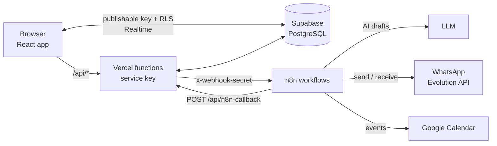

# Forkly — AI-Powered Leads CRM

Forkly captures leads from any source, drafts personalized follow-up messages with AI, requires **human approval** before anything is sent, and delivers messages over **WhatsApp**. It also manages the sales pipeline, demo bookings, campaigns, and follow-up tasks from one dashboard.

> **Status: interactive prototype.** The UI, database layer, and API functions are working. The AI drafting, WhatsApp delivery, and calendar booking run in **n8n** workflows that you connect yourself (see [n8n integration](#n8n-integration)). Without them, the app falls back to simulated sends and local demo data.

<!-- Add a screenshot: save it as docs/overview.png and uncomment the next line.

-->

## Table of contents

- [Features](#features)
- [How it works](#how-it-works)
- [Tech stack](#tech-stack)
- [Project structure](#project-structure)
- [Getting started](#getting-started)
- [Environment variables](#environment-variables)
- [n8n integration](#n8n-integration)
- [API reference](#api-reference)
- [Consent and WhatsApp rules](#consent-and-whatsapp-rules)
- [Roles and permissions](#roles-and-permissions)
- [Data model](#data-model)
- [Deploy to Vercel](#deploy-to-vercel)
- [Security notes](#security-notes)
- [Known limitations](#known-limitations)
- [Troubleshooting](#troubleshooting)

## Features

**Sales workflow**
- **Leads**: add, edit, archive, CSV import (validation and duplicate skip), bulk assign and bulk stage move, quick call and WhatsApp actions.
- **Lead profile**: contact details, lead score, conversation history, tasks, bookings, and marketing consent.
- **Sales pipeline**: drag-and-drop board (New, Contacted, Interested, Demo Booked, Trial, Converted, Lost).
- **My Tasks**: per-salesperson view of follow-ups due today, overdue items, and upcoming appointments.
- **Bookings and follow-ups**: demo scheduling with create, update, and cancel synced to n8n (Google Calendar and confirmation messages).

**AI and messaging**
- **Approval Center**: every AI-drafted message waits for a human to approve, edit, or regenerate it. Nothing is sent without approval.
- **WhatsApp inbox**: conversation view with templates and offer attachments.
- **Templates**: message library with `{{variables}}`.
- **Offers**: offer builder with live preview of the offer card and the WhatsApp message.

**Campaigns**
- **Campaigns**: segment, message, schedule, approve, then send. Flow: Draft, Submit, manager Approve, Sent or Scheduled.
- **Segments**: interested-not-booked, demo-not-bought, past clients, no reply for N days, interested in a service.
- **Win-back**: finds idle Interested, Demo Booked, and Trial leads, prepares a message per lead, and sends each one to the Approval Center.
- **Analytics**: sent, delivered, replies, interested, and bookings per campaign.

**Platform**
- **Reports**: funnel, source performance, team leaderboard, trend charts, CSV export.
- **Command palette** (`Ctrl/Cmd+K`) and a **notification center** (pending approvals, overdue tasks, demos today, stale leads).
- **Automation rules**: round-robin assignment, auto-created first follow-up task, stale-lead threshold.
- **Roles**: Admin, Sales Manager, Salesperson, Viewer.
- **Realtime**: all CRM tables update live through Supabase Realtime.

## How it works



1. **Lead arrives** (form, WhatsApp, Meta Lead Ads, or manual entry) and is saved in Supabase.
2. **n8n drafts a follow-up** with an LLM and stores it as a message with status `Pending Approval`.
3. **A human reviews it** in the Approval Center and can edit or regenerate it.
4. **Approve and Send** calls `POST /api/approve`, which marks the message `Sending` and hands it to n8n. n8n sends it over WhatsApp.
5. **n8n reports back** with `message.status` (Accepted, Delivered, Failed), `message.inbound` (customer replied), `booking.status`, and `lead.created` through `POST /api/n8n-callback`.

Reliability rules built into the flow:
- **Idempotent approve**: a message already Sending, Accepted, or Delivered is never sent twice. If the send fails, the approval returns to Pending so it can be retried.
- **Provider acceptance is not delivery**: the UI shows "Delivered" only when the provider confirms it. Simulated messages are never shown as delivered.
- **Graceful fallback**: if n8n or the service key is missing, Approve falls back to a simulated send. If Supabase is missing, the app runs on `localStorage` with seed data.

## Tech stack

| Layer | Technology |
|---|---|
| Frontend | React 19, TypeScript, Vite 7, Tailwind CSS v4, React Router 7 |
| UI | Radix UI (dialog, tooltip), Framer Motion, Recharts, dnd-kit, Lucide, Sonner |
| State | React context, Redux Toolkit, Immer |
| Database | Supabase (PostgreSQL, Row Level Security, Realtime) |
| Server | Vercel serverless functions in `/api` (run inside the Vite dev server locally) |
| Automation | n8n |
| Messaging | WhatsApp through Evolution API |
| AI | LLM calls run inside n8n workflows (the app itself holds no AI keys) |

## Project structure

```
forkly/
├── api/                    Vercel functions (service-key operations, n8n bridge)
│   ├── _lib/               shared helpers: env, supabase admin client, n8n caller, phone parsing
│   ├── approve.ts          approve a message and hand it to n8n
│   ├── regenerate.ts       ask n8n for a fresh AI draft
│   ├── bookings.ts         send booking events to n8n
│   ├── campaign-send.ts    approve / cancel a campaign
│   ├── campaigns-run.ts    send scheduled campaigns that are due
│   ├── n8n-callback.ts     n8n → CRM events
│   ├── wipe-chats.ts       admin-only chat reset
│   └── health.ts           configuration flags (never values)
├── src/
│   ├── pages/              Overview, Leads, LeadProfile, Pipeline, MyDay, Reports, Templates,
│   │                       Campaigns, Offers, WhatsApp, Approvals, Bookings, Activity, Settings
│   ├── components/         Layout, CommandPalette, Notifications, ConsentPanel, ui kit
│   ├── context/            AppContext (data store, Supabase sync, realtime)
│   └── lib/                types, db, permissions, segments, campaign stats, automation, CSV, seed data
├── supabase/
│   ├── migrations/         001_init … 005_campaigns
│   └── RUN_ALL.sql         all migrations in one file
├── scripts/                one-click Vercel deploy
└── vercel.json             SPA rewrites (API routes excluded)
```

## Getting started

**Prerequisites:** Node.js 20+ and a Supabase project (free plan is fine). n8n is optional for local exploration.

1. **Install**
   ```bash
   npm install
   ```
2. **Create the database.** In the Supabase SQL Editor, run `supabase/RUN_ALL.sql` (or the files in `supabase/migrations/` in order).
3. **Configure environment.**
   ```bash
   cp .env.example .env.local
   ```
   Fill in the Supabase URL, the publishable key, and the service (secret) key. See [Environment variables](#environment-variables).
4. **Run**
   ```bash
   npm run dev
   ```
   The `/api/*` functions run inside the Vite dev server, so everything works locally.

Other scripts:

| Command | What it does |
|---|---|
| `npm run build` | type-check and production build |
| `npm run lint` | ESLint |
| `npm run preview` | serve the production build |
| `npm run deploy` | deploy to Vercel from your machine |

Without any configuration the app still starts, using local demo data stored in the browser.

## Environment variables

Copy `.env.example` to `.env.local`. Never commit `.env.local`.

| Variable | Scope | Purpose |
|---|---|---|
| `VITE_SUPABASE_URL` | browser | Supabase project URL |
| `VITE_SUPABASE_PUBLISHABLE_KEY` | browser | `sb_publishable_…` key (public) |
| `SUPABASE_URL` | server | same project URL, used by `/api/*` |
| `SUPABASE_SERVICE_ROLE_KEY` | server | `sb_secret_…` key. Bypasses RLS. Keep private |
| `N8N_WEBHOOK_BASE` | server | n8n **production** webhook base, no trailing slash, not `/webhook-test` |
| `N8N_WEBHOOK_SECRET` | server | shared secret sent in the `x-webhook-secret` header |
| `N8N_PATH_APPROVE` | server | webhook path for approve (default `dem_approve`) |
| `N8N_PATH_BOOKINGS` | server | webhook path for bookings (default `dem_bookind`) |
| `N8N_PATH_REGENERATE` | server | webhook path for AI regenerate (default `dem_regenerated`) |
| `N8N_PATH_CAMPAIGN` | server | webhook path for campaigns (default `dem_campaign`) |
| `N8N_PATH_WIPE` | server | webhook path for chat wipe (default `res-wipe-all`) |
| `DEFAULT_GULF_CC` | server | country code for local numbers (default `966`) |
| `PUBLIC_APP_URL` | server | public app URL, sent to n8n as `callback_url` |
| `VERCEL_TOKEN` | local only | used by `npm run deploy` |
| `VERCEL_TEAM_ID`, `VERCEL_PROJECT_NAME` | local only | optional deploy settings |

Variables prefixed with `VITE_` are public. The app refuses to use a secret or service-role key in the browser.

To check what the server sees, open `GET /api/health`. It returns configuration flags only, never values.

## n8n integration

The app talks to n8n through webhooks protected by the `x-webhook-secret` header. Create these webhook nodes (POST, Header Auth) and keep the paths in sync with your env variables:

| Path (default) | Called by | Purpose |
|---|---|---|
| `dem_approve` | `/api/approve` | send an approved message over WhatsApp |
| `dem_bookind` | `/api/bookings` | create, update, or cancel a booking (Calendar and confirmation message) |
| `dem_regenerated` | `/api/regenerate` | return a fresh AI draft as `{ "content": "..." }` |
| `dem_campaign` | `/api/campaign-send` | send a campaign to a list of recipients |
| `res-wipe-all` | `/api/wipe-chats` | clear n8n-side chat data after a wipe |

**Approve payload** (`message.approved`):

```json
{
  "event": "message.approved",
  "approval_id": "…", "message_id": "…",
  "message_type": "whatsapp", "objective": "…", "content": "…",
  "lead": { "id": "…", "name": "…", "restaurant_name": "…", "phone": "…", "phone_intl": "…", "email": "…", "source": "…", "status": "…" },
  "callback_url": "https://your-app/api/n8n-callback",
  "sent_at": "…"
}
```

In the payloads and the database, `restaurant_name` is the column that stores the lead's company or business name.

Respond with any 2xx and, ideally, `{ "provider_message_id": "wamid…", "status": "Accepted by Provider" }`.

**Callback events** (n8n → `POST /api/n8n-callback`, header `x-webhook-secret`):

| Event | Body |
|---|---|
| `message.status` | `{ message_id \| provider_message_id, status: "Delivered" \| "Failed" \| "Accepted by Provider", error? }` |
| `message.inbound` | `{ phone, content, provider_message_id? }` |
| `lead.created` | `{ name, restaurant_name?, phone, email?, source?, notes?, consent?, consent_source? }` |
| `booking.status` | `{ booking_id, status: "Scheduled" \| "Confirmed" \| "Completed" \| "Cancelled" \| "No-show" }` |

**Campaigns:** `campaign.send` carries `recipients[]` (`message_id`, `phone_intl`, `content`, `use_template`, …), `template`, and `attachment`. Answer 2xx immediately, loop with delays, and report each result with `message.status`.

**Scheduled campaigns:** call `POST /api/campaigns-run` every 5 minutes from an n8n Schedule Trigger (header `x-webhook-secret`). Vercel Hobby crons run daily only, so no cron is configured in `vercel.json`.

**Meta Lead Ads:** send `consent: true` in `lead.created` only if the form had a marketing opt-in checkbox.

> If you export your n8n workflows into this repo, remove API keys, credential IDs, and any hardcoded `apikey` values first. Use n8n credentials instead of values written inside nodes.

## API reference

All endpoints live in `/api` and use the Supabase service key on the server.

| Endpoint | Method | Auth | Description |
|---|---|---|---|
| `/api/approve` | POST | none yet | `{ approval_id, edited_content?, reviewer_id? }` approve and send |
| `/api/regenerate` | POST | none yet | `{ approval_id, reviewer_id?, instructions? }` new AI draft |
| `/api/bookings` | POST | none yet | `{ booking_id, action: created \| updated \| cancelled }` |
| `/api/campaign-send` | POST | none yet | `{ campaign_id, action: approve \| cancel, reviewer_id? }` |
| `/api/campaigns-run` | GET, POST | `x-webhook-secret` | send scheduled campaigns that are due |
| `/api/n8n-callback` | POST | `x-webhook-secret` | n8n → CRM events |
| `/api/wipe-chats` | POST | Admin role check | `{ confirm: "WIPE", user_id }` delete all chat data |
| `/api/health` | GET | none | configuration flags |

## Consent and WhatsApp rules

Enforced in the UI and checked again on the server at send time:

- Only leads with `consent_status = opted_in` receive marketing messages. The default is `unknown`, which means not messaged. Record consent on the lead profile, or in bulk on the Segments tab, together with its source.
- Replies such as `STOP`, `UNSUBSCRIBE`, or Arabic opt-out phrases set the lead to `opted_out` automatically.
- Outside the 24-hour customer window, WhatsApp only allows **approved templates**. Campaigns and win-back messages carry a template name and language.
- Maximum **one marketing message per contact per 7 days**.
- Win-back messages go to the Approval Center. Nothing is sent without a human approving it.

## Roles and permissions

Defined in `src/lib/permissions.ts`.

| Permission | Admin | Sales Manager | Salesperson | Viewer |
|---|:-:|:-:|:-:|:-:|
| Create and edit leads | ✓ | ✓ | ✓ | |
| Archive, import, bulk actions | ✓ | ✓ | | |
| Move pipeline stage | ✓ | ✓ | ✓ | |
| Review approvals | ✓ | ✓ | | |
| Manage offers | ✓ | ✓ | | |
| Create bookings | ✓ | ✓ | ✓ | |
| Create campaigns | ✓ | ✓ | ✓ | |
| Approve campaigns | ✓ | ✓ | | |
| Team reports | ✓ | ✓ | | |
| Settings and chat wipe | ✓ | | | |

These rules are enforced in the UI. Mirror them with Supabase RLS before production.

## Data model

Ten tables in the `public` schema (see `supabase/migrations/`):

| Table | Holds |
|---|---|
| `profiles` | team members and roles |
| `leads` | contact, company, source, status, score inputs, consent, interests |
| `conversations`, `messages` | WhatsApp thread and individual messages with delivery status |
| `approvals` | approval queue for AI-drafted messages |
| `bookings` | demo appointments |
| `follow_up_tasks` | tasks and reminders |
| `offers` | offer templates |
| `campaigns` | marketing campaigns and their schedule |
| `activity_logs` | audit trail of actions |

Lead stages: `New`, `Contacted`, `Interested`, `Demo Booked`, `Trial`, `Converted`, `Lost`.
Lead sources: `Meta Lead Ads`, `WhatsApp`, `Website`, `Referral`, `Cold Outreach`, `Google Ads`, `Event`, `Partner`.

## Deploy to Vercel

**Option A: from the repo.** Import the repository into Vercel, add the environment variables from the table above under Project Settings, and deploy.

**Option B: one click from your machine.** Set `VERCEL_TOKEN` in `.env.local`, then run `npm run deploy` (or `DEPLOY.bat` on Windows). The first run creates a project named `forkly` (override with `VERCEL_PROJECT_NAME`); later runs update the same project and URL.

After deploying, set `PUBLIC_APP_URL` to the live URL so n8n receives the correct `callback_url`, and point `N8N_WEBHOOK_BASE` at an n8n instance reachable from the internet.

## Security notes

- `VITE_*` variables are public. Keep the service key in `SUPABASE_SERVICE_ROLE_KEY` only.
- The RLS policies in the migrations are **permissive demo policies**, and `/api/*` has **no user authentication yet**. Add Supabase Auth and tighten RLS before connecting real customers.
- Webhook calls between the app and n8n are authenticated with a shared secret compared in constant time.
- Never hardcode WhatsApp, Supabase, or LLM keys inside n8n nodes or this repo. Use credentials and environment variables, and rotate any key that was ever committed.

## Known limitations

- Prototype data: the sample leads and dashboards are demo data.
- The in-app "Generate AI Follow-up" button creates a sample draft. Real AI drafting happens in n8n and arrives through the approval flow.
- No user login yet. The current user is chosen from the sidebar for demo purposes.
- External integrations (WhatsApp, Calendar, LLM) are not bundled. You connect them through your own n8n workflows.

## Troubleshooting

**"Cannot reach `<ref>.supabase.co`"**
1. Open the Supabase dashboard and confirm the project exists. If the ref in `.env.local` is not listed, copy the URL from Project Settings → API into `VITE_SUPABASE_URL` and `SUPABASE_URL`.
2. If the project shows **Paused** (free plan pauses after inactivity), click **Restore project** and wait until it is healthy.
3. Run `supabase/RUN_ALL.sql` in that project's SQL Editor.
4. Put the publishable key in `VITE_SUPABASE_PUBLISHABLE_KEY` and the secret key in `SUPABASE_SERVICE_ROLE_KEY`.
5. Restart `npm run dev` (Vite reads env only at startup). On Vercel, change the variables and redeploy.

**n8n calls fail:** open `/api/health`. If `n8n` is `false`, `N8N_WEBHOOK_BASE` or `N8N_WEBHOOK_SECRET` is missing. Use the **production** webhook URL, not `/webhook-test`, and make sure the workflow is active.

## Author

Built by **Faris Lashen** — AI automation engineer (n8n, AI agents, Supabase, React).
